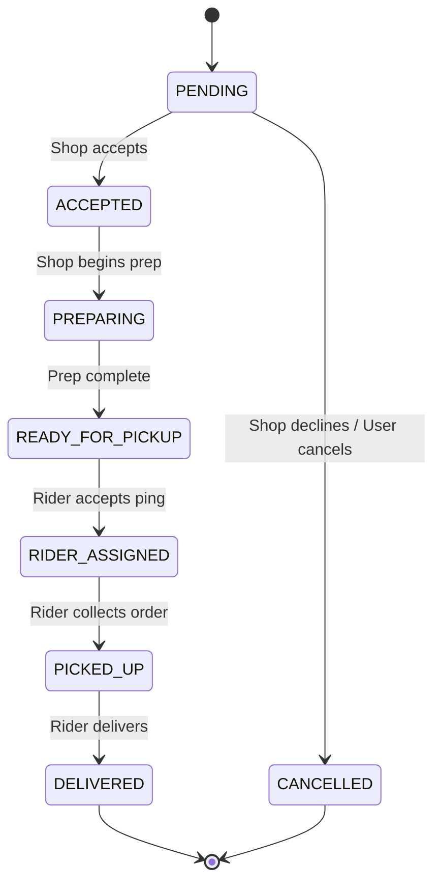
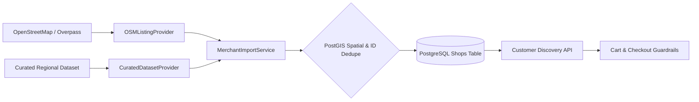
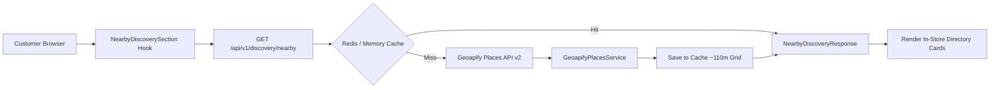
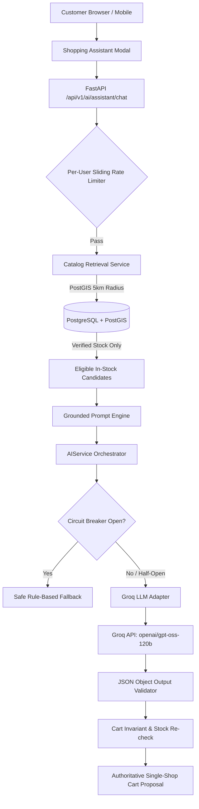
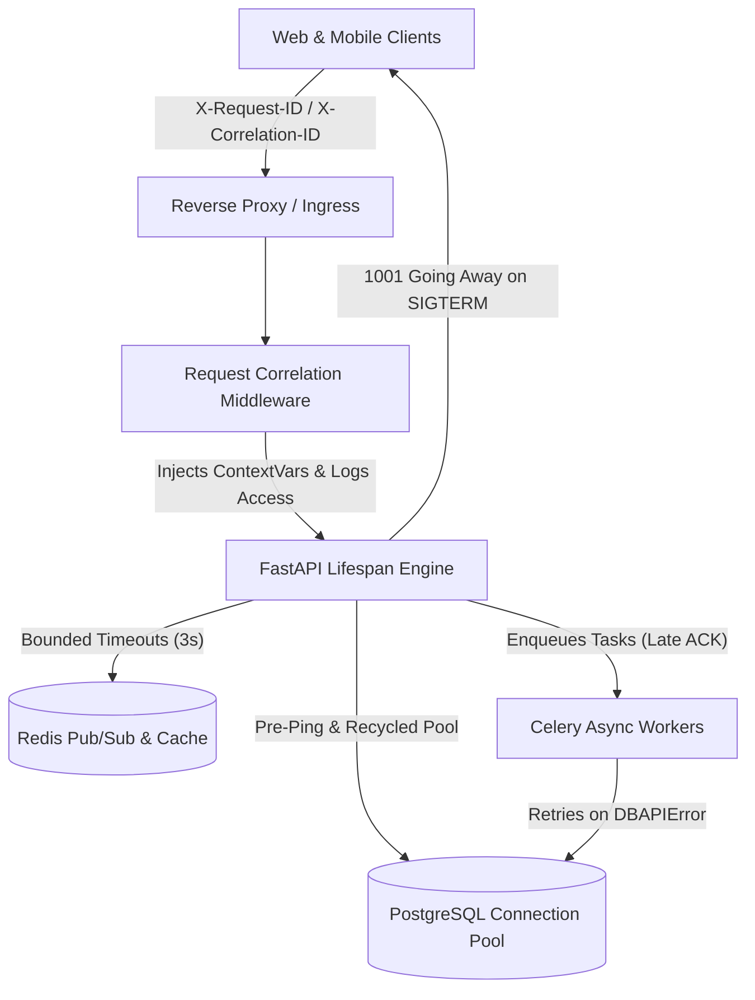

# Dukaanly - System Architecture

## 1. High-Level Architecture
Dukaanly is structured as a **Modular Monolith**. For a solo build, a microservices approach introduces unnecessary operational complexity. 

- **Frontend**: React + Vite + TypeScript (SPA)
- **Backend**: Python + FastAPI
- **Database**: PostgreSQL with PostGIS extension
- **Cache/PubSub**: Redis

### Flow Diagram
```mermaid
flowchart TD
    Client[Web/Mobile Client (React)]
    API[FastAPI Backend]
    DB[(PostgreSQL + PostGIS)]
    Cache[(Redis)]
    
    Client -- REST / WebSockets --> API
    API -- Read/Write --> DB
    API -- Caching / PubSub --> Cache
```

## 2. Component Responsibilities
- **Frontend (React)**: Handles UI/UX, routing (React Router), state management (Zustand + TanStack Query), form validation (React Hook Form + Zod), and map rendering (Leaflet).
- **Backend (FastAPI)**: Exposes REST APIs, handles WebSocket connections, enforces RBAC, validates business logic, interfaces with DB.
- **Database (PostgreSQL)**: Persists all core data. Uses PostGIS for spatial queries (finding nearby shops/riders).
- **Cache/Task Coordination (Redis)**: Manages WebSocket pub/sub for real-time tracking, caches frequent queries (e.g., master catalog), and coordinates lightweight background tasks via FastAPI `BackgroundTasks`.

## 3. Core Mechanisms

### A. Order Lifecycle State Machine
Orders follow a strict state machine to prevent invalid transitions.


### B. Inventory Consistency Mechanism (Concurrency Safety)
To prevent race conditions (e.g., two users buying the last item simultaneously), we use **Optimistic Locking**:
- The `Inventory` table includes a `version` integer column.
- On update: `UPDATE inventory SET stock = stock - X, version = version + 1 WHERE product_id = Y AND version = Z`.
- If 0 rows are updated, it means another transaction modified the stock first. The backend raises an exception (HTTP 409 Conflict), and the user is prompted to retry or notified of out-of-stock.

### B2. Transactional Inventory Reservation & Expiry Lifecycle (Stage 8)
- **Authoritative Stock Invariant**: `Available Stock = Inventory.stock`. Stock is atomically decremented upon checkout and a corresponding durable `InventoryReservation` record is created in status `active`.
- **Authoritative Single Source of Truth**: PostgreSQL is the sole durable store for inventory reservations, stock, and payment states. Redis TTL is never the sole mechanism for releasing stock.
- **Durable Expiration**: Expired reservations are swept by a periodic Celery task (`reconcile_expired_inventory_reservations`) every 60s using `SELECT ... FOR UPDATE SKIP LOCKED`.
- **Exactly-Once Restoration**: Release of active reservations uses atomic conditional updates (`UPDATE ... WHERE status = 'active'`). Stock is restored only when `rowcount == 1`. Consumed reservations are never released or restored.
- **See Full Specification**: [`docs/INVENTORY_RESERVATION_LIFECYCLE.md`](file:///c:/Users/ASUS/Documents/VIT/Dukaanly/docs/INVENTORY_RESERVATION_LIFECYCLE.md)

### C. Delivery & Rider Assignment Strategy (Phase 1)
For the MVP, deliveries are managed manually to ensure domain correctness before adding automated geolocation.
1. **Creation**: When an order transitions to `confirmed` (via payment), a Shop Owner manually initiates a `Delivery` record.
2. **Assignment Rules**: 
   - Only `Shop Owners` (managing their store's orders) or `Admins` can assign riders.
   - The assigned rider must have an active `RiderProfile` and `is_available = True`.
   - **Workload Concurrency**: Using a PostgreSQL partial unique index, a rider is strictly constrained to **one active delivery** (`assigned`, `picked_up`, or `out_for_delivery`). Simultaneous assignments to the same rider will structurally throw a `409 Conflict`.
3. **State Sync**: As a Rider updates the Delivery status (`picked_up` -> `out_for_delivery` -> `delivered`), the `Order` model is logically synced in real-time within the same transaction to maintain cross-domain consistency.

### C2. Rider Assignment Workflow (PostGIS - Deferred)
When real-time tracking is implemented, assignment will use:
`SELECT * FROM riders WHERE status = 'ONLINE' AND ST_DWithin(location, shop_location, 5000);`

### D. Payment Architecture & Integration
Dukaanly abstracts payment processing to allow provider flexibility:

> [!NOTE] 
> As per the project scope, **real-money transactions and production payment gateways are not implemented**. 
> The application uses a provider abstraction to simulate payment flows, verifying idempotency and state changes strictly in a sandbox/mocked environment.

- **Provider Interface (PaymentProvider)**: Defines generic contracts (create_payment_order, erify_payment, erify_webhook).
- **Adapter**: Implements the generic interface mapping Dukaanly domain models to mocked or sandbox responses.
- **State Isolation**: The Payment state (created, captured, ailed) is isolated from the Order state (pending, confirmed). An order transitions to confirmed ONLY when a payment is safely captured or a webhook verifies it.
- **Idempotency**: Webhooks and verification endpoints are fully idempotent. Re-sending a webhook will not duplicate order state transitions. Re-sending a webhook will not duplicate order state transitions.

### E. Real-Time Tracking Architecture
- **WebSockets**: The client establishes a WS connection to the FastAPI server.
- **Pub/Sub**: When a rider updates their location via REST or WS, the backend publishes the update to a Redis channel (e.g., `order_tracking:<order_id>`).
- **Broadcast**: Any client subscribed to that WebSocket room receives the live coordinate updates.

### F. Public Merchant Discovery & Listing Integration (Provider-Adapter Architecture)
To support hyperlocal discovery of real candidate merchants (e.g., in Patna, Bihar) while safeguarding commercial operations, Dukaanly implements an extensible provider-adapter ingestion pipeline.



#### Core Architectural Guarantees:
1. **Four-Tier Separation of Concerns**:
   - **Discovered Listing**: Publicly indexed entity (`verification_status = 'discovered'`, `is_orderable = False`, `owner_id = NULL`). Visible in local directory searches.
   - **Verified Merchant**: Business claimed/verified by a legitimate owner (`verification_status = 'verified'`).
   - **Orderable Shop**: Verified merchant with configured inventory (`is_orderable = True`).
   - **Delivery-Eligible Shop**: Verified, orderable shop operating within the active delivery radius of available delivery riders.
2. **Provider-Adapter Abstraction (`BaseListingProvider`)**:
   - Standardized interface returning `NormalizedListing` objects with canonical coordinates, normalized categories, contact info, and legal attribution (e.g., ODbL 1.0 for OSM).
   - Rate limiting, exponential backoff, and strict geographic bounding boxes (lat: 25.50 - 25.70, lon: 85.00 - 85.25 for Patna).
3. **Idempotent Ingestion & Deduplication**:
   - **Source Identifier**: Partial unique index `uq_shops_source_source_id` on `(source, source_id)`.
   - **Spatial Deduplication**: PostGIS `ST_DWithin(location, candidate_point, 25)` detects existing shops within 25 meters, preventing duplicate entries.
4. **Radius Policies**:
   - **Discovery Radius**: Clamped between 100m and 10,000m (10 km maximum) across both backend API and frontend Zustand state store.
   - **Delivery Radius**: Dynamic calculation based on shop operational radius; unverified directory listings are strictly flagged with `is_delivery_eligible = False`.
5. **Server-Side Guardrails**:
   - Cart additions (`/api/v1/cart/items`) and checkout transactions (`/api/v1/orders/checkout`) reject unverified or non-orderable listings with HTTP 400 Bad Request.
6. **Import Batch Tracking & Concurrency-Safe Rollback / Archival**:
   - Each import execution creates an `import_batches` entry (`ImportBatch`) recording provider, source dataset, status, timestamps, and candidate counts.
   - Imported listings store `import_batch_id` referencing the batch.
   - Rollback operations (`rollback_import_batch`) execute inside a transaction with row-level locks (`with_for_update()`), verify that no records have been claimed or verified by merchants, verify absence of foreign key dependencies, and offer safe batch archival (`mode='archive'`) or atomic deletion (`mode='delete'`).

### G. Live Nearby Store Discovery via Geoapify Places API
To allow customers to discover real-world nearby retail stores in their immediate vicinity without manual database imports, Dukaanly integrates with the Geoapify Places API v2 via a transient read-only discovery proxy (`GET /api/v1/discovery/nearby`).



#### Core Architectural Guarantees:
1. **Strict Two-Tier Separation**:
   - **Verified Dukaanly Merchants**: Orderable, delivery-eligible via PostGIS, backed by PostgreSQL `shops` table.
   - **External Directory Listings**: Transient read-only records (`NearbyStoreListing`) labeled with badge `📍 Directory Listing · In-store Only`. They cannot be added to cart (`HTTP 400`/`404`), claimed, or checked out.
2. **Zero Database Writes Invariant**:
   - External discovery results are purely transient DTOs and are NEVER written to the database `shops` table. No migrations are added for external provider payloads.
3. **Backend-Only Credential Protection**:
   - `GEOAPIFY_API_KEY` is loaded strictly on the backend from environment variables. The API key is never logged, never exposed to the frontend, and stripped from all error responses.
4. **Coordinate Grid Caching & Credit Conservation**:
   - Coordinates are bucketed into a ~110m spatial grid (`round(coord, 3)`).
   - Redis primary cache with bounded in-memory LRU+TTL fallback (`GEOAPIFY_CACHE_TTL_SECONDS=300`).
   - Responses include `cached: true/false` flag and mandatory provider attribution: `Powered by Geoapify | © OpenStreetMap contributors`.
5. **Resilience & Safe Upstream Mapping**:
   - Upstream 401/403 errors are mapped to HTTP 503 without leaking provider secrets.
   - Upstream 429 rate limits are mapped to HTTP 429 with retry-after headers.
   - Upstream 5xx outages trigger exponential backoff before returning HTTP 502 Bad Gateway.

## 4. Security Considerations
- **Auth**: JWT for access, HTTP-only secure cookies for refresh tokens (or strict local storage if required by mobile).
- **Resource Ownership**: Endpoints must verify `user_id == resource.owner_id`. A Shop Owner cannot modify another shop's catalog.
- **Input Validation**: Strictly enforced via Pydantic on backend and Zod on frontend.

## 5. Folder Structure
```text
Dukaanly/
├── frontend/             # React application
│   ├── src/
│   │   ├── components/   # Shared UI components (shadcn)
│   │   ├── features/     # Feature-based modules (auth, shops, orders)
│   │   ├── hooks/
│   │   ├── pages/
│   │   ├── services/     # API clients
│   │   ├── store/        # Zustand stores
│   │   └── utils/
├── backend/              # FastAPI application
│   ├── app/
│   │   ├── api/          # Route handlers
│   │   ├── core/         # Config, security, dependencies
│   │   ├── db/           # Session, migrations (Alembic)
│   │   ├── models/       # SQLAlchemy models
│   │   ├── schemas/      # Pydantic models
│   │   ├── services/     # Business logic
│   │   └── websockets/   # WS connection managers
├── docs/                 # Project documentation
├── tests/                # E2E and integration tests
├── docker-compose.yml
└── AGENTS.md             # AI Agent Instructions
```
## Real-Time Infrastructure (WebSockets & Redis)
For real-time delivery state and location updates, Dukaanly uses FastAPI WebSockets and Redis Pub/Sub for event distribution.
The crucial architectural rule is that **PostgreSQL remains the single authoritative source of truth**.

### Transport Flow
1. **Source of Truth**: When a rider sends a location update via WebSocket, it is first validated, timestamped, and written to PostgreSQL using PostGIS geometry.
2. **Event Distribution**: After the database transaction successfully commits, an event payload is published to a delivery-scoped Redis channel (e.g. \dukaanly:delivery:<id>\).
3. **Client Transport**: FastAPI WebSocket handlers subscribe to these Redis channels and broadcast events to connected, authorized clients (customers, shop owners).

### Real-Time Characteristics
- **No Redis Canonical State**: Redis is not used to persist location history, active assignments, or delivery status. If Redis crashes, PostgreSQL is unharmed, though real-time broadcasts might fail temporarily.
- **Location Throttling**: The backend enforces \RIDER_LOCATION_MIN_UPDATE_INTERVAL_SECONDS\ (default: 1s) to prevent spamming the database with rapid updates.
- **Reconnection Semantics**: Clients connecting or reconnecting receive a \connection.ready\ snapshot directly from the authoritative database state. There is no historical replay of events.
- **Isolation**: Each WebSocket connection is authenticated via JWT and strictly authorized to access only the delivery belonging to its user role (customer, shop owner, rider).

## 6. Road Routing & Delivery Optimization (OSRM)

### Overview
Dukaanly integrates the Open Source Routing Machine (OSRM) driving API to replace straight-line Euclidean distance approximations with road-network routing, driving duration estimations, and GeoJSON route geometries.

### Invariants & Guarantees
1. **PostGIS as Non-Negotiable Spatial Index Filter**:
   - Initial candidate filtering strictly uses database-level PostGIS spatial queries (`ST_DWithin` and `ST_Distance` on `Geography` columns). OSRM is only invoked to evaluate the top candidates within this initial spatial radius.
2. **Documented Candidate Ranking Policy**:
   - **Routable Candidates (`routing_status: 'routed'`)**: Candidates for which OSRM Table returns a valid driving duration are ranked by `estimated_duration_seconds` (fastest road travel first).
   - **Unroutable Candidates (`routing_status: 'unroutable'`)**: Candidates within the PostGIS search radius where OSRM returns null duration (e.g. separated by impassable obstacles, pedestrian zones) are partitioned **behind all routable candidates**. They sort amongst themselves by Euclidean PostGIS `distance_meters`. An unroutable candidate can **never outrank** a valid routable candidate.
   - **PostGIS Fallback (`routing_status: 'straight_line_fallback'`)**: If OSRM is unreachable, times out, or if all candidates are unroutable, candidate selection gracefully falls back to PostGIS straight-line distance order. Dispatch and checkout never fail due to routing provider outages.
3. **Fallback Transparency**:
   - The route API (`GET /api/v1/deliveries/{id}/route`) **never synthesizes or fabricates artificial road polylines** when OSRM fails. It explicitly returns HTTP 504 (timeout), 404 (no drivable route), or 502 (upstream error).
   - Candidate responses maintain `road_distance_meters: null` and `estimated_duration_seconds: null` when routing is unavailable. Straight-line distance is never represented as verified road distance.
4. **Route Privacy & Authorization**:
   - Access to `/api/v1/deliveries/{id}/route` is strictly verified server-side:
     - Order Customer (`user_id == order.customer_id`)
     - Fulfilling Shop Owner (`user_id == shop.owner_id`)
     - Assigned Rider (`user_id == rider.user_id`)
     - Superuser / Platform Administrator (`actor.role == admin`)
   - Unrelated customers, shop owners, and unassigned riders are denied with `HTTP 403 Forbidden`. Non-existent IDs return `HTTP 404 Not Found`. Unauthenticated requests return `HTTP 401 Unauthorized`.

## 7. Smart Delivery ETA Engine

### Overview
Dukaanly's Smart Delivery ETA engine provides deterministic, phase-aware arrival estimation. It combines actual OSRM road travel calculations, elapsed shop preparation tracking, stage-aware operational buffers, dynamic arrival uncertainty windows, and real-time WebSocket distribution.

### Mathematical Formulations

#### 1. Elapsed Preparation Time Deduction
Preparation time automatically decrements as wall-clock time passes:
$$T_{\text{prep remaining}} = \max\left(0,\, T_{\text{prep expected}} - (T_{\text{now}} - T_{\text{prep start}})\right)$$
If preparation has not yet begun, the full expected preparation time ($T_{\text{prep expected}}$, default: 10 mins) is included.

#### 2. Phase-Aware Component Matrix
Components drop to zero as delivery milestones are achieved:

| Delivery State | Preparation | Matching Wait | Rider to Shop Travel | Shop to Customer Travel | Doorstep Handoff | Uncertainty Buffer |
| :--- | :---: | :---: | :---: | :---: | :---: | :---: |
| **`pending`** | $\checkmark$ Dynamic | $\checkmark$ Buffer (3 min) | $0$ (Unassigned) | $\checkmark$ Shop $\to$ Customer | $\checkmark$ Buffer (3 min) | $\pm 6$ min |
| **`assigned`** | $\checkmark$ Dynamic | $0$ | $\checkmark$ Rider $\to$ Shop Road | $\checkmark$ Shop $\to$ Customer | $\checkmark$ Buffer (3 min) | $\pm 5$ min |
| **`picked_up`** / **`out_for_delivery`** | $0$ | $0$ | $0$ | $\checkmark$ Current $\to$ Customer | $\checkmark$ Buffer (3 min) | $\pm 3$ min |
| **`delivered`** | $0$ | $0$ | $0$ | $0$ | $0$ | $0$ (Terminal) |

#### 3. Dynamic Arrival Window Calculation
$$T_{\text{earliest}} = \max\left(0,\, T_{\text{remaining}} - B_{\text{uncertainty}}\right)$$
$$T_{\text{latest}} = T_{\text{remaining}} + B_{\text{uncertainty}}$$
Arrival timestamps:
- $\text{earliest\_at} = T_{\text{now}} + T_{\text{earliest}}$
- $\text{latest\_at} = T_{\text{now}} + T_{\text{latest}}$
Displayed transparently as e.g. **`18–25 min`** with explicit disclaimer: *"Not a guaranteed delivery time"*.

### Routing Failure & Fallback Policy
1. **OSRM Verified Route (`source: 'osrm'`)**: Genuine road-network duration from OSRM. Standard duration is never misrepresented as a live-traffic prediction.
2. **Conservative Fallback (`source: 'fallback_estimate'`)**: When OSRM is unreachable or times out, the service calculates urban road distance ($1.3 \times$ Haversine) at $22\,\text{km/h}$ city speed.
3. **Unavailable (`source: 'unavailable'`)**: If essential coordinates are missing, returns remaining duration 0 and unavailable status without fabricating fake numbers.

### Real-Time Event Flow & Anti-Thrashing
1. **Authoritative Persistence**: PostgreSQL stores the canonical snapshot (`eta_earliest_at`, `eta_latest_at`, `eta_remaining_seconds`, `eta_source`, `eta_version`) before broadcasting.
2. **Pub/Sub Broadcast**: Emits `delivery.eta_updated` to Redis Pub/Sub after database commit.
3. **Throttled Recalculation**:
   - Status transitions and preparation adjustments force immediate recalculation.
   - Movement GPS updates trigger rerouting only if movement $\ge 50\,\text{m}$ and elapsed time $\ge 30\,\text{s}$ (`ETA_MIN_RECALC_INTERVAL_SECONDS`).
   - Periodic reconciliation is performed by Celery task `reconcile_active_deliveries_eta` for deliveries with snapshots older than `ETA_MAX_SNAPSHOT_AGE_SECONDS` (180s).
   - Recalculations automatically cease when delivery reaches `delivered` or `cancelled`.

## 8. AI Subsystem & Groq Real-Provider Integration (Phase 2.6)

### Overview
Dukaanly features an enterprise-grade, privacy-conscious AI foundation and a grounded conversational shopping assistant. The system supports multi-provider LLM inference with Groq as the primary high-throughput real provider, accompanied by an in-memory mock provider for zero-cost, offline, deterministic test automation.



### Core Invariants & Engineering Guarantees

1. **Grounded Catalog Retrieval (Zero Hallucination)**:
   - The LLM only receives real verified partner products discovered via PostGIS spatial filtering (`ST_DWithin` on 5 km serviceability radius) with `stock > 0`.
   - Out-of-stock items, unverified directory listings (e.g., Geoapify Places), and shops outside the delivery radius are structurally filtered out before prompt generation.
2. **Groq Real-Provider Adapter**:
   - **Candidate Model**: `openai/gpt-oss-120b` (verified on live Groq endpoint with sub-second latency and high instruction compliance).
   - **Endpoint Sanitization**: Canonical base URL `https://api.groq.com/openai/v1` with deduplication protection preventing duplicate `/chat/completions/chat/completions` paths.
   - **Authentication**: Strict Bearer token authorization via server-side environment (`GROQ_API_KEY` or `AI_API_KEY`).
   - **Structured Output**: Enforces native `response_format={"type": "json_object"}` with server-side validation against `ShoppingAssistantPayload`.
3. **Resilience, Rate Limiting & Circuit Breaker**:
   - **Bounded Concurrency**: Managed by `asyncio.Semaphore(5)` to prevent client-side socket saturation.
   - **Failure Classification**:
     - *Terminal client/auth errors (400, 401, 403, 404, 413, 422)* fail fast immediately without blind retries (`AIAuthenticationError`, `AIModelNotFoundError`).
     - *Transient errors (429, 502, 503, 504)* retry with exponential backoff respecting `Retry-After` headers.
   - **Circuit Breaker**: Trips to `OPEN` after 3 consecutive failures, entering a 30s cooldown before transitioning to `HALF-OPEN` probe mode.
4. **Authoritative Cart & Security Guardrails**:
   - Cart proposals require explicit user review and approval before calling standard cart APIs (`/api/v1/cart/items`).
   - Multi-shop items in proposals are detected and flagged with explicit shop-switching warnings.
   - Prices and stock counts are re-verified from the authoritative PostgreSQL database upon cart addition; fabricated or hallucinated prices are rejected.
5. **Secret Redaction & Diagnostic Observability**:
   - All authorization tokens, `gsk_...` keys, and `sk-...` strings are automatically masked (`***REDACTED***`) from logs and error strings via `redact_secrets()`.
   - `GET /api/v1/ai/status` exposes provider health, feature flags, and endpoint sanitization without leaking credentials.
   - `GET /api/v1/ai/diagnostic/check` executes lightweight, bounded live probes measuring roundtrip latency and reporting structured error categories.

## 9. Transactional Inventory Reservation & Checkout Lifecycle (Stage 8)

### Architectural Summary
Dukaanly utilizes a durable PostgreSQL-backed inventory reservation model (`InventoryReservation`) to guarantee that checkouts prevent overselling without permanently locking stock during abandoned or delayed payment flows.

1. **Optimistic Concurrency Control (OCC)**:
   - Cart checkouts sort items deterministically by `product_id ASC` and update `Inventory.stock` atomically using integer version checks (`version = version + 1`).
   - Active reservations are created with UTC `expires_at = now() + INVENTORY_RESERVATION_TTL_SECONDS`.
2. **Authoritative Expiration & Reconciliation Policy**:
   - Background Celery task `reconcile_expired_inventory_reservations` periodically scans for active reservations where `expires_at <= now()`.
   - Evaluates payment status against the payment provider via a 4-way decision matrix:
     - **Confirmed Success (`captured` / `paid`)**: Consumes reservations permanently; transitions order to `confirmed`.
     - **Definitive Failure (`failed` / `cancelled`)**: Releases reservations (`status: released`), restores stock atomically via OCC, cancels order.
     - **Unknown Outcome / In-Flight (Network error, 5xx, `processing`, `authorized`)**: **Retains active reservation**; defers to next reconciliation cycle without releasing stock or cancelling order.
     - **Pending Beyond Policy (`created` / `unpaid` after TTL)**: Releases reservations (`status: expired`), restores stock, cancels order.
3. **Safe Compensating Workflow**:
   - If a late `payment.captured` webhook or client verification arrives for an already cancelled order, the order is **never** revived and stock is **never** double-sold.
   - The system marks `payment.status = refunded`, invokes `PaymentProvider.refund_payment(...)` to immediately return funds to the customer, and emits a structured audit alert.
4. **Unified Recovery Coordination & Prohibition of Independent Restoration**:
   - To prevent dual recovery paths from attempting to restore the same inventory, Stage 6 recovery tasks (`reconcile_stale_pending_orders`, `reconcile_stale_unaccepted_orders`) delegate reservation-backed orders exclusively to the centralized reservation service (`release_order_reservations`).
   - Independent raw SQL inventory increments are strictly forbidden for reservation-backed orders.
   - Status updates enforce atomic `WHERE status IN (:allowed_from)` conditions and check `rowcount == 1`, ensuring racing workers or overlapping recovery tasks never double-restore stock.
5. **Canonical Transaction Lock Ordering & Deadlock Prevention**:
   - To prevent PostgreSQL transaction deadlocks (`40P01`) across competing operations, all database routines strictly observe the canonical lock hierarchy:
     $$\text{Order} \longrightarrow \text{Payment} \longrightarrow \text{InventoryReservation} \longrightarrow \text{Inventory (sorted by product\_id ASC)}$$
   - Checkout, payment verification, payment webhooks, customer cancellation, shop rejection, reservation expiry, and Stage 6 recovery all follow this sequence without lock inversion.
   - Non-locking MVCC lookup of `order_id` in payment verification and webhooks ensures `Order` is locked before `Payment`, preventing lock inversion deadlocks against concurrent background recovery tasks.

## 10. Production Reliability, Observability & Operational Resilience (Stage 9)

### Architectural Overview
Dukaanly enforces end-to-end production reliability, fault tolerance, and comprehensive observability across all tiers of its modular monolith:



### 1. PostgreSQL Connection Pool Resilience & Session Hygiene
- **Connection Pool Configuration**:
  - `pool_size = 10`, `max_overflow = 10`, `pool_timeout = 30.0s`.
  - `pool_recycle = 1800s` (30 minutes) to eliminate stale connections closed by PostgreSQL firewalls or idle timeouts.
  - `pool_pre_ping = True` using a lightweight `SELECT 1` ping to detect and discard stale TCP connections before handing them to route handlers.
  - Connect timeout enforced at `5.0s`.
- **Session Lifecycle Hygiene**:
  - `get_db()` FastAPI dependency guarantees that any unhandled exception or cancelled asyncio task immediately triggers `await session.rollback()` before reaching `finally: await session.close()`.
  - Prevents leaked transactions in `idle in transaction` state.
  - Real-time pool metrics (`size`, `checked_in`, `checked_out`, `overflow`) are continuously reported via `get_db_pool_status()`.

### 2. Redis Resilience & Failure Recovery Policies
- **Bounded Timeouts**:
  - Socket connect timeout: `3.0s`.
  - Socket read/write timeout: `3.0s`.
  - Connection pool capped at `50` connections to prevent file descriptor saturation.
- **Fail-Open Rate Limiting**:
  - Redis connection drops or timeouts during rate limit checks log structured warnings and fail open rather than crashing commerce traffic.
- **PubSub Lifecycle & Reconnection**:
  - Delivery location tracking listener tasks handle Redis reconnections automatically and are cancelled cleanly with `asyncio.gather(*tasks, return_exceptions=True)` during application shutdown.

### 3. Celery Worker & Beat Reliability Architecture
- **Fault-Tolerant Worker Configuration**:
  - `task_acks_late = True`: Tasks are acknowledged only *after* successful completion. Crashed worker processes cause Celery to re-queue the task rather than silently dropping it.
  - `task_reject_on_worker_lost = True`: Rejects tasks if worker processes exit unexpectedly or are killed by OOM killers.
  - `worker_prefetch_multiplier = 1`: Disables bulk task prefetching so long-running reconciliation tasks do not starve other workers.
  - `task_soft_time_limit = 240s` / `task_time_limit = 300s`: Enforces graceful self-termination (`SoftTimeLimitExceeded`) before hard worker termination.
- **Selective Retry Policy**:
  - Periodic reconciliation tasks strictly retry on transient infrastructure failures (`OperationalError`, `DBAPIError`) with exponential backoff (`retry_backoff=True`, `max_retries=3`).
  - Business logic errors (e.g. invalid order transition) do not retry endlessly.

### 4. Structured JSON Logging & Request Correlation
- **Structured JSON Formatting**: Emits production-grade JSON log lines containing `timestamp`, `level`, `service`, `message`, `request_id`, `correlation_id`, `task_id`, and `duration_ms`.
- **ContextVar Propagation**: `request_id` and `correlation_id` are maintained in asynchronous thread-local context variables and automatically included across all log records without manual parameter passing.
- **Request Correlation Middleware**:
  - Inspects incoming `X-Request-ID` and `X-Correlation-ID` headers.
  - Generates a UUID4 hex identifier if missing.
  - Injects `X-Request-ID` into all HTTP response headers and exception payloads.
  - Suppresses high-frequency `/api/v1/health/live` probe logging to eliminate log noise in container orchestrators.
- **Sensitive Field Redaction**: Automatically filters dictionaries and strings, redacting passwords, password hashes, access tokens, refresh tokens, API keys, credit cards, and cryptographic secrets as `[REDACTED]`.

### 5. Centralized Error Handling & Secret Sanitization
- Centralized FastAPI exception handlers for `HTTPException`, `RequestValidationError`, `SQLAlchemyError`, `RedisError`, and general `Exception`.
- **Zero Information Leakage**: Database schema definitions, SQL queries, table names, file paths, and Python tracebacks are never exposed to clients in production (`APP_ENV=production` or `DEBUG=False`).
- Consistent error payload schema:
  ```json
  {
    "detail": "Database service temporarily unavailable",
    "request_id": "a9b8c7d6e5f4..."
  }
  ```

### 6. Graceful Lifespan & Teardown Protocol
FastAPI lifespan context manager handles graceful application shutdown:
1. **WebSocket Eviction**: Calls `manager.close_all(code=1001, reason="Server shutting down")` to inform active tracking clients with standard RFC 6455 Going Away status.
2. **PubSub Listener Termination**: Awaits cancellation and cleanup of background Redis PubSub subscriber loops.
3. **HTTP Client Disposal**: Disposes persistent OSRM async routing client sessions.
4. **Redis Connection Pool Shutdown**: Closes active Redis connection pools via `client.aclose()`.
5. **Database Engine Disposal**: Disposes SQLAlchemy async engine pool connections cleanly via `engine.dispose()`.

### 7. Liveness, Readiness & Operational Diagnostics
- `GET /api/v1/health/live`: Fast, dependency-free liveness probe returning `200 OK` as long as the FastAPI process is responsive.
- `GET /api/v1/health/ready`: Deep readiness probe verifying reachability of PostgreSQL, Redis, and core configuration within strict `2.5s` timeouts. Returns `503 Service Unavailable` if dependencies fail.
- `GET /api/v1/health/diagnostics`: Administrative telemetry endpoint protected by strict Admin RBAC (`require_role(UserRole.admin)`). Emits real-time pool metrics, Redis latency, Celery configuration, and WebSocket counts with zero PII or credentials.


### Architectural Summary
Dukaanly utilizes a durable PostgreSQL-backed inventory reservation model (`InventoryReservation`) to guarantee that checkouts prevent overselling without permanently locking stock during abandoned or delayed payment flows.

1. **Optimistic Concurrency Control (OCC)**:
   - Cart checkouts sort items deterministically by `product_id ASC` and update `Inventory.stock` atomically using integer version checks (`version = version + 1`).
   - Active reservations are created with UTC `expires_at = now() + INVENTORY_RESERVATION_TTL_SECONDS`.
2. **Authoritative Expiration & Reconciliation Policy**:
   - Background Celery task `reconcile_expired_inventory_reservations` periodically scans for active reservations where `expires_at <= now()`.
   - Evaluates payment status against the payment provider via a 4-way decision matrix:
     - **Confirmed Success (`captured` / `paid`)**: Consumes reservations permanently; transitions order to `confirmed`.
     - **Definitive Failure (`failed` / `cancelled`)**: Releases reservations (`status: released`), restores stock atomically via OCC, cancels order.
     - **Unknown Outcome / In-Flight (Network error, 5xx, `processing`, `authorized`)**: **Retains active reservation**; defers to next reconciliation cycle without releasing stock or cancelling order.
     - **Pending Beyond Policy (`created` / `unpaid` after TTL)**: Releases reservations (`status: expired`), restores stock, cancels order.
3. **Safe Compensating Workflow**:
   - If a late `payment.captured` webhook or client verification arrives for an already cancelled order, the order is **never** revived and stock is **never** double-sold.
   - The system marks `payment.status = refunded`, invokes `PaymentProvider.refund_payment(...)` to immediately return funds to the customer, and emits a structured audit alert.
4. **Unified Recovery Coordination & Prohibition of Independent Restoration**:
   - To prevent dual recovery paths from attempting to restore the same inventory, Stage 6 recovery tasks (`reconcile_stale_pending_orders`, `reconcile_stale_unaccepted_orders`) delegate reservation-backed orders exclusively to the centralized reservation service (`release_order_reservations`).
   - Independent raw SQL inventory increments are strictly forbidden for reservation-backed orders.
   - Status updates enforce atomic `WHERE status IN (:allowed_from)` conditions and check `rowcount == 1`, ensuring racing workers or overlapping recovery tasks never double-restore stock.
5. **Canonical Transaction Lock Ordering & Deadlock Prevention**:
   - To prevent PostgreSQL transaction deadlocks (`40P01`) across competing operations, all database routines strictly observe the canonical lock hierarchy:
     $$\text{Order} \longrightarrow \text{Payment} \longrightarrow \text{InventoryReservation} \longrightarrow \text{Inventory (sorted by product\_id ASC)}$$
   - Checkout, payment verification, payment webhooks, customer cancellation, shop rejection, reservation expiry, and Stage 6 recovery all follow this sequence without lock inversion.
   - Non-locking MVCC lookup of `order_id` in payment verification and webhooks ensures `Order` is locked before `Payment`, preventing lock inversion deadlocks against concurrent background recovery tasks.


