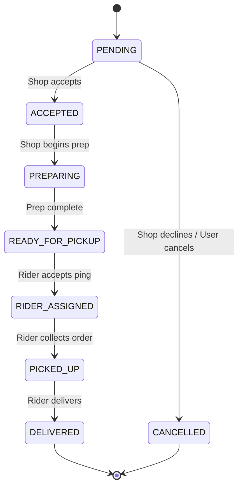

# Dukaanly - System Architecture

## 1. High-Level Architecture
Dukaanly is structured as a **Modular Monolith**. For a solo build, a microservices approach introduces unnecessary operational complexity. 

- **Frontend**: React + Vite + TypeScript (SPA)
- **Backend**: Python + FastAPI
- **Database**: PostgreSQL with PostGIS extension
- **Cache/PubSub**: Redis

### Flow Diagram
```mermaid
flowchart TD
    Client[Web/Mobile Client (React)]
    API[FastAPI Backend]
    DB[(PostgreSQL + PostGIS)]
    Cache[(Redis)]
    
    Client -- REST / WebSockets --> API
    API -- Read/Write --> DB
    API -- Caching / PubSub --> Cache
```

## 2. Component Responsibilities
- **Frontend (React)**: Handles UI/UX, routing (React Router), state management (Zustand + TanStack Query), form validation (React Hook Form + Zod), and map rendering (Leaflet).
- **Backend (FastAPI)**: Exposes REST APIs, handles WebSocket connections, enforces RBAC, validates business logic, interfaces with DB.
- **Database (PostgreSQL)**: Persists all core data. Uses PostGIS for spatial queries (finding nearby shops/riders).
- **Cache/Task Coordination (Redis)**: Manages WebSocket pub/sub for real-time tracking, caches frequent queries (e.g., master catalog), and coordinates lightweight background tasks via FastAPI `BackgroundTasks`.

## 3. Core Mechanisms

### A. Order Lifecycle State Machine
Orders follow a strict state machine to prevent invalid transitions.


### B. Inventory Consistency Mechanism (Concurrency Safety)
To prevent race conditions (e.g., two users buying the last item simultaneously), we use **Optimistic Locking**:
- The `Inventory` table includes a `version` integer column.
- On update: `UPDATE inventory SET stock = stock - X, version = version + 1 WHERE product_id = Y AND version = Z`.
- If 0 rows are updated, it means another transaction modified the stock first. The backend raises an exception (HTTP 409 Conflict), and the user is prompted to retry or notified of out-of-stock.

### C. Delivery & Rider Assignment Strategy (Phase 1)
For the MVP, deliveries are managed manually to ensure domain correctness before adding automated geolocation.
1. **Creation**: When an order transitions to `confirmed` (via payment), a Shop Owner manually initiates a `Delivery` record.
2. **Assignment Rules**: 
   - Only `Shop Owners` (managing their store's orders) or `Admins` can assign riders.
   - The assigned rider must have an active `RiderProfile` and `is_available = True`.
   - **Workload Concurrency**: Using a PostgreSQL partial unique index, a rider is strictly constrained to **one active delivery** (`assigned`, `picked_up`, or `out_for_delivery`). Simultaneous assignments to the same rider will structurally throw a `409 Conflict`.
3. **State Sync**: As a Rider updates the Delivery status (`picked_up` -> `out_for_delivery` -> `delivered`), the `Order` model is logically synced in real-time within the same transaction to maintain cross-domain consistency.

### C2. Rider Assignment Workflow (PostGIS - Deferred)
When real-time tracking is implemented, assignment will use:
`SELECT * FROM riders WHERE status = 'ONLINE' AND ST_DWithin(location, shop_location, 5000);`

### D. Payment Architecture & Integration
Dukaanly abstracts payment processing to allow provider flexibility:
- **Provider Interface (`PaymentProvider`)**: Defines generic contracts (`create_payment_order`, `verify_payment`, `verify_webhook`).
- **Adapter (`RazorpayPaymentProvider`)**: Implements the generic interface mapping Dukaanly domain models to Razorpay specific REST API calls.
- **State Isolation**: The Payment state (`created`, `captured`, `failed`) is isolated from the Order state (`pending`, `confirmed`). An order transitions to `confirmed` ONLY when a payment is safely captured or a webhook verifies it.
- **Idempotency**: Webhooks and verification endpoints are fully idempotent. Re-sending a webhook will not duplicate order state transitions.

### E. Real-Time Tracking Architecture
- **WebSockets**: The client establishes a WS connection to the FastAPI server.
- **Pub/Sub**: When a rider updates their location via REST or WS, the backend publishes the update to a Redis channel (e.g., `order_tracking:<order_id>`).
- **Broadcast**: Any client subscribed to that WebSocket room receives the live coordinate updates.

## 4. Security Considerations
- **Auth**: JWT for access, HTTP-only secure cookies for refresh tokens (or strict local storage if required by mobile).
- **Resource Ownership**: Endpoints must verify `user_id == resource.owner_id`. A Shop Owner cannot modify another shop's catalog.
- **Input Validation**: Strictly enforced via Pydantic on backend and Zod on frontend.

## 5. Folder Structure
```text
Dukaanly/
├── frontend/             # React application
│   ├── src/
│   │   ├── components/   # Shared UI components (shadcn)
│   │   ├── features/     # Feature-based modules (auth, shops, orders)
│   │   ├── hooks/
│   │   ├── pages/
│   │   ├── services/     # API clients
│   │   ├── store/        # Zustand stores
│   │   └── utils/
├── backend/              # FastAPI application
│   ├── app/
│   │   ├── api/          # Route handlers
│   │   ├── core/         # Config, security, dependencies
│   │   ├── db/           # Session, migrations (Alembic)
│   │   ├── models/       # SQLAlchemy models
│   │   ├── schemas/      # Pydantic models
│   │   ├── services/     # Business logic
│   │   └── websockets/   # WS connection managers
├── docs/                 # Project documentation
├── tests/                # E2E and integration tests
├── docker-compose.yml
└── AGENTS.md             # AI Agent Instructions
```
