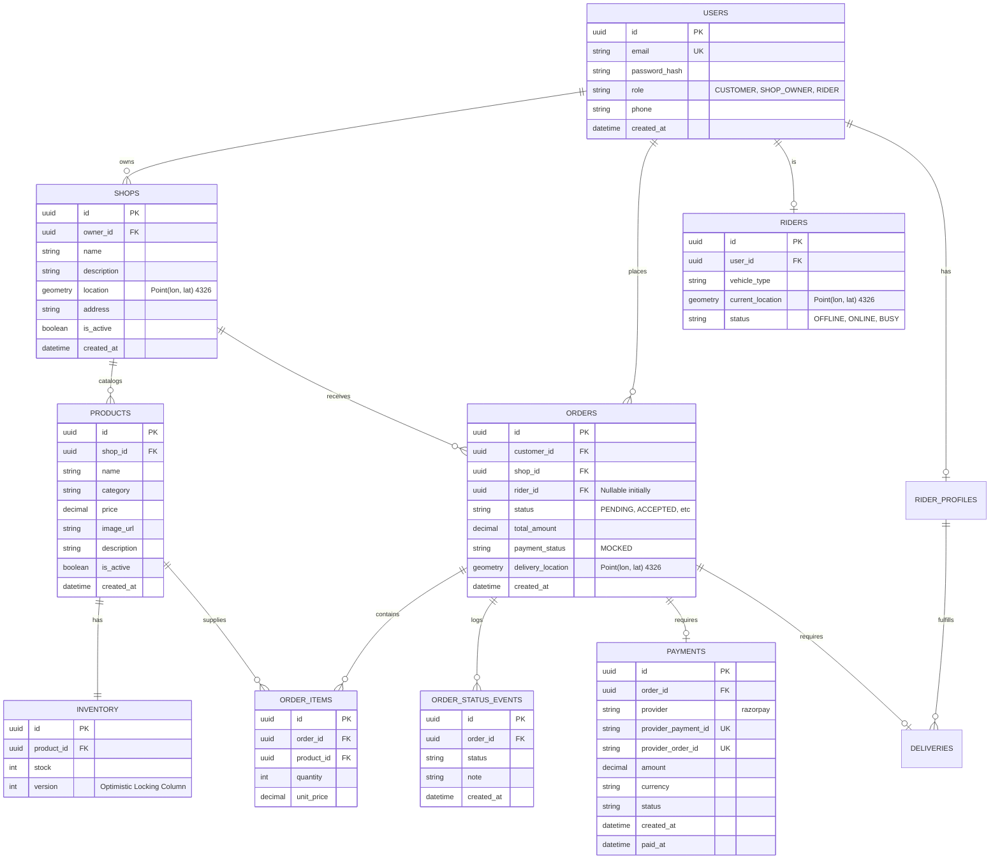

# Dukaanly - Database Design

## 1. Overview
The database is PostgreSQL, utilizing the **PostGIS** extension for geospatial queries. All schema changes will be managed via Alembic.

## 2. Entity-Relationship Diagram



## 3. Entity Responsibilities

- **Shop owns Product**: Each product listing is explicitly owned by a single shop.
- **Product**: Contains all catalog information (name, description, category, image) and price. It does **not** contain stock quantities.
- **Inventory**: Contains all stock-related state (stock level, version column). An inventory record belongs to exactly one product.

## 4. Concurrency Control (Optimistic Locking)
To handle concurrent stock updates, the `INVENTORY` table includes a `version` column.

When an order is placed, the system attempts to deduct stock like this:
```sql
UPDATE inventory 
SET stock = stock - :quantity, 
    version = version + 1 
WHERE product_id = :product_id 
  AND stock >= :quantity 
  AND version = :expected_version;
```
If the row count returned is `0`, a race condition occurred (another transaction changed the stock or stock is insufficient). The backend will abort the transaction and return a `409 Conflict`.

## 5. Geospatial Indexing
To support fast nearest-rider and nearby-shop queries, we create **GiST indexes** on the geometry columns.

```sql
CREATE INDEX idx_shops_location ON shops USING GIST (location);
CREATE INDEX idx_riders_current_location ON riders USING GIST (current_location);
```
Using EPSG:4326 (WGS 84) for standard Longitude/Latitude representation. PostGIS functions like `ST_DWithin` will be cast to geography to calculate distances in meters.

## 6. Delivery Domain
- **RiderProfile**: Exists only for users with the `rider` role. Contains `is_available` to indicate willingness to accept new deliveries.
- **Delivery**: 1:1 mapped to an `Order`. Includes operational statuses (`pending`, `assigned`, `picked_up`, `out_for_delivery`, `delivered`, `cancelled`).
- **Partial Unique Index**: `idx_active_delivery_per_rider` ensures a Rider can only have **one** Delivery where `status` is in `[assigned, picked_up, out_for_delivery]` simultaneously.
