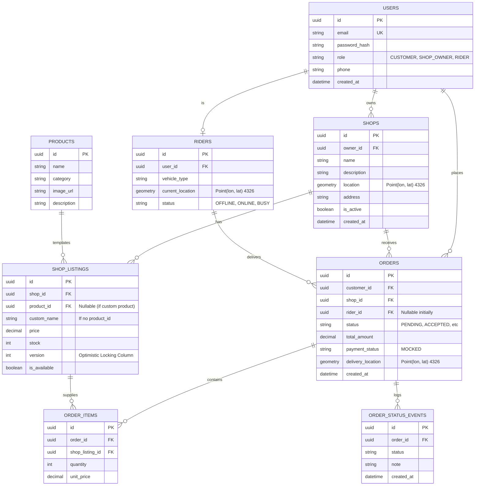

# Dukaanly - Database Design

## 1. Overview
The database is PostgreSQL, utilizing the **PostGIS** extension for geospatial queries. All schema changes will be managed via Alembic.

## 2. Entity-Relationship Diagram



## 3. Concurrency Control (Optimistic Locking)
To handle concurrent stock updates, the `SHOP_LISTINGS` table includes a `version` column.

When an order is placed, the system attempts to deduct stock like this:
```sql
UPDATE shop_listings 
SET stock = stock - :quantity, 
    version = version + 1 
WHERE id = :listing_id 
  AND stock >= :quantity 
  AND version = :expected_version;
```
If the row count returned is `0`, a race condition occurred (another transaction changed the stock or stock is insufficient). The backend will abort the transaction and return a `409 Conflict`.

## 4. Geospatial Indexing
To support fast nearest-rider and nearby-shop queries, we create **GiST indexes** on the geometry columns.

```sql
CREATE INDEX idx_shops_location ON shops USING GIST (location);
CREATE INDEX idx_riders_current_location ON riders USING GIST (current_location);
```
Using EPSG:4326 (WGS 84) for standard Longitude/Latitude representation. PostGIS functions like `ST_DWithin` will be cast to geography to calculate distances in meters.
