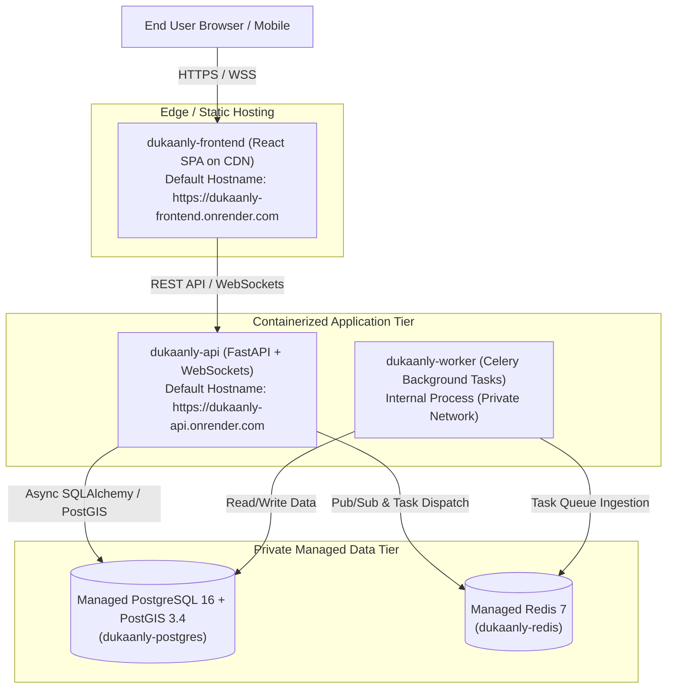

# Dukaanly — Production Deployment Plan & Environment Readiness

## 1. Hosting Architecture Overview (Cloud PaaS: Render)

Dukaanly is deployed as a modular monolith composed of 5 coordinated services managed through [`render.yaml`](../render.yaml):



---

## 2. Service Definitions & Assigned Hostnames

| Service | Type | Runtime | Build / Start Command | Assigned Hostname / Ingress | Health Check |
|---|---|---|---|---|---|
| **`dukaanly-frontend`** | Static Site | Node.js 20 | `npm ci && npm run build` (publish: `dist`) | `https://dukaanly-frontend.onrender.com` | SPA rewrite `/* -> /index.html` |
| **`dukaanly-api`** | Web Service | Docker (`backend/Dockerfile`) | `uvicorn app.main:app --host 0.0.0.0 --port 8000` | `https://dukaanly-api.onrender.com` | `GET /api/v1/health/live` |
| **`dukaanly-worker`** | Background Worker | Docker (`backend/Dockerfile`) | `celery -A app.core.celery_app.celery_app worker --loglevel=info` | None (Private worker process) | Celery ping / process supervisor |
| **`dukaanly-postgres`**| Managed Database | PostgreSQL 16 | PostGIS extension auto-provisioned via pre-deploy | Private network only | Managed DB health |
| **`dukaanly-redis`**   | Managed Key-Value | Redis 7 | Managed Redis cluster | Private network only | Managed Redis ping |

> [!NOTE]
> If custom apex or subdomains are configured on Render (e.g. `dukaanly.com` and `api.dukaanly.com`), Render's `fromService: property: url` continues to dynamically resolve the canonical service URL, keeping `ALLOWED_ORIGINS` and `VITE_API_URL` synchronized without manual configuration changes.

---

## 3. Environment Variables & Secret Sharing via `envVarGroups`

To guarantee that both the API and worker receive **the identical JWT secret** without exposing credentials in git or build logs, the Render blueprint defines an environment variable group (`dukaanly-shared-config`) with `generateValue: true`:

### Root-Level Shared Environment Group (`dukaanly-shared-config`)
| Variable | Value / Generation | Purpose |
|---|---|---|
| `APP_ENV` | `production` | Enforces production security validations across all services |
| `DEBUG` | `false` | Disables tracebacks, mock data fallbacks, and interactive docs |
| `ALLOW_MOCK_PAYMENTS` | `false` | Strictly disables mock payment processing in production |
| `JWT_ALGORITHM` | `HS256` | Standard HMAC-SHA256 signing algorithm |
| `JWT_SECRET_KEY` | `generateValue: true` | Render generates a cryptographically random 256-bit secret shared identically across API and worker |

### Service-Specific Injected Variables
- **`dukaanly-api`**:
  - `fromGroup: dukaanly-shared-config`
  - `DATABASE_URL`: `fromDatabase: dukaanly-postgres` (connectionString)
  - `REDIS_URL`: `fromService: dukaanly-redis` (connectionString)
  - `ALLOWED_ORIGINS`: `fromService: dukaanly-frontend` (property: url $\to$ `https://dukaanly-frontend.onrender.com`)
- **`dukaanly-worker`**:
  - `fromGroup: dukaanly-shared-config`
  - `DATABASE_URL`: `fromDatabase: dukaanly-postgres` (connectionString)
  - `REDIS_URL`: `fromService: dukaanly-redis` (connectionString)
- **`dukaanly-frontend`**:
  - `VITE_API_URL`: `fromService: dukaanly-api` (property: url $\to$ `https://dukaanly-api.onrender.com`)
  - `VITE_WS_URL`: `""` (dynamically derived by `getDeliveryWsUrl`)

---

## 4. Automated PostGIS & Database Migration Release Phase

Render runs an ephemeral **pre-deploy release phase** before switching customer traffic to new containers:

```bash
python -m app.db.init_predeploy && alembic -c alembic.ini upgrade head
```

### Pre-Deploy Execution Sequence:
1. **Connectivity Check**: Establishes async connection to PostgreSQL via `DATABASE_URL`.
2. **PostGIS Availability Audit**: Queries `pg_available_extensions` to confirm that `postgis` binary is present in the PostgreSQL 16 engine. If missing, execution halts with exit code 1 to protect the database from broken partial migrations.
3. **Automated Extension Provisioning**: Executes `CREATE EXTENSION IF NOT EXISTS postgis;` idempotently.
4. **Operational Readiness Assert**: Executes `SELECT PostGIS_Version();` and logs the verified PostGIS version (e.g. `>= 3.4`).
5. **Schema Migration**: Executes `alembic -c alembic.ini upgrade head` to apply all pending schema revisions. The initial migration `4cf0f0146f95` also contains an idempotent `op.execute("CREATE EXTENSION IF NOT EXISTS postgis;")` safety net.

### Safety Guarantees:
- Application startup commands (`uvicorn`, `celery`) **never** execute migrations or table mutations.
- If a migration or PostGIS check fails, the deployment halts immediately; existing running containers remain active and customer traffic is untouched.
- Zero downtime: Traffic switches to newly provisioned containers only after both the release phase and container health checks pass.

---

## 5. Domain, TLS, CORS & WebSocket Normalization

1. **Automatic TLS 1.3**:
   - Render automatically provisions and renews Let's Encrypt certificates for all `.onrender.com` and custom domains.
   - Plain HTTP requests are 301 redirected to HTTPS with HSTS enabled.
2. **CORS Alignment**:
   - `ALLOWED_ORIGINS` is injected dynamically from `dukaanly-frontend`'s assigned URL (`https://dukaanly-frontend.onrender.com`).
   - Browser cross-origin requests from the React SPA are authorized with full credential support.
3. **URL & WebSocket Normalization**:
   - The frontend Axios client normalizes `VITE_API_URL` to ensure `/api/v1` is present regardless of whether the injected URL contains a trailing path.
   - `getDeliveryWsUrl` automatically converts `https:` $\to$ `wss:` and appends `/api/v1/ws/deliveries/{id}`, guaranteeing zero WebSocket handshake mismatches behind PaaS TLS edge proxies.

---

## 6. Live Deployment Verification Runbook

Following initial production deployment, run the verification sequence:

### Step 1: Health & Dependency Readiness Probes
Inspect HTTP status and complete JSON response bodies:
```bash
# 1. Liveness Probe (process is running)
curl -s -i https://dukaanly-api.onrender.com/api/v1/health/live
# Expected: HTTP/2 200 OK
# Body: {"status":"alive"}

# 2. Readiness Probe (database & redis connectivity)
curl -s -i https://dukaanly-api.onrender.com/api/v1/health/ready
# Expected: HTTP/2 200 OK
# Body: {"status":"ready","database":"connected","redis":"connected"}
```
> [!IMPORTANT]
> The readiness probe executes `SELECT 1` on PostgreSQL and a `PING` on Redis. Both subsystems must report `"connected"`.

### Step 2: PostGIS Verification via API
Verify spatial queries execute on the database:
```bash
curl -s "https://dukaanly-api.onrender.com/api/v1/shops/nearby?lat=12.9716&lng=77.5946&radius_km=10"
# Expected: HTTP/2 200 OK with shop array (spatial ST_DWithin query succeeded)
```

### Step 3: Production Security Guardrails
Verify mock payments fail closed:
```bash
curl -s -i -X POST https://dukaanly-api.onrender.com/api/v1/payments/mock-process \
  -H "Content-Type: application/json" \
  -d '{"order_id": "00000000-0000-0000-0000-000000000000"}'
# Expected: HTTP/2 403 Forbidden or 401 Unauthorized (never 200 OK in production)
```

### Step 4: Real-Time WebSocket Delivery Stream
Connect to `wss://dukaanly-api.onrender.com/api/v1/ws/deliveries/{delivery_id}?token={jwt_token}` and verify receipt of initial `connection.ready` event.

---

## 7. Decoupled Rollback & Disaster Recovery Procedures

Application code rollback and database recovery are strictly separated operations:

### A. Application Code Rollback (Zero Data Impact)
- If a regression is discovered in the API, worker, or frontend code that **does not involve a schema change**:
  1. Open Render Dashboard $\to$ Service (`dukaanly-api`, `dukaanly-worker`, or `dukaanly-frontend`).
  2. Select **Deploys** $\to$ Locate the previous known-good deployment artifact.
  3. Click **Rollback to this deploy**.
  4. Render immediately shifts traffic back to the previous immutable container image.

### B. Database Schema Migration Rollback (Controlled Schema Reversal)
- If a newly applied migration caused application errors:
  ```bash
  # Target the specific down-revision
  alembic -c alembic.ini downgrade -1
  ```
  > [!WARNING]
  > Never roll back container code while an incompatible schema migration is active. Always align the database schema before or synchronously with container rollback.

### C. Disaster Recovery & Point-In-Time Restoration (Disaster Only)
- In the event of catastrophic data corruption or accidental drop:
  1. Managed daily snapshots are maintained by Render PostgreSQL.
  2. Provision a new target database or restore the backup archive via `pg_restore`:
     ```bash
     pg_restore --clean --if-exists -d dukaanly_recovery_db dukaanly_backup.dump
     ```
  3. Validate PostGIS extensions and data integrity before updating `DATABASE_URL`.
