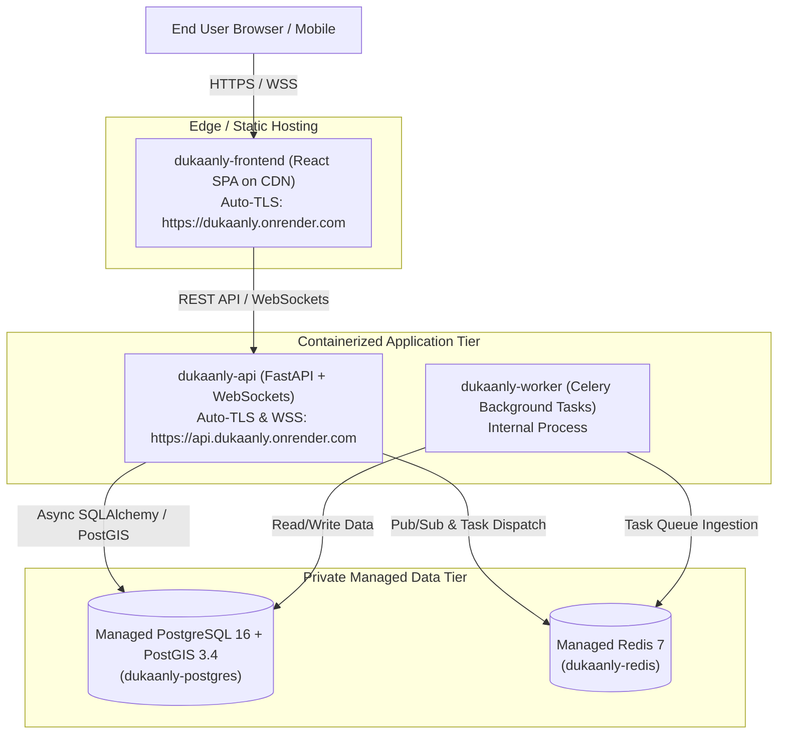

# Dukaanly — Production Deployment Plan & Environment Readiness

## 1. Hosting Architecture Overview (Cloud PaaS: Render / Railway)

Dukaanly is deployed as a modular monolith composed of 5 coordinated services:



---

## 2. Service Definitions

| Service | Type | Runtime | Build / Start Command | Health Check |
|---|---|---|---|---|
| **`dukaanly-frontend`** | Static Site | Node.js 20 | `npm ci && npm run build` (publish: `dist`) | SPA rewrite `/* -> /index.html` |
| **`dukaanly-api`** | Web Service | Docker (`backend/Dockerfile`) | `uvicorn app.main:app --host 0.0.0.0 --port 8000` | `GET /api/v1/health/live` |
| **`dukaanly-worker`** | Background Worker | Docker (`backend/Dockerfile`) | `celery -A app.core.celery_app.celery_app worker --loglevel=info` | Celery ping / process supervisor |
| **`dukaanly-postgres`**| Managed Database | PostgreSQL 16 | PostGIS extension auto-provisioned | Managed DB health |
| **`dukaanly-redis`**   | Managed Key-Value | Redis 7 | Managed Redis cluster | Managed Redis ping |

---

## 3. Environment Variables & Secret Management

Secrets must be injected exclusively through the cloud platform's dashboard or environment configuration, **never committed to source control**.

### Backend API & Worker Configuration
| Variable | Value / Source | Purpose |
|---|---|---|
| `APP_ENV` | `production` | Enforces production security validations |
| `DEBUG` | `false` | Disables interactive tracebacks and Swagger UI docs |
| `ALLOW_MOCK_PAYMENTS` | `false` | Strictly disables mock payment processing in production |
| `JWT_SECRET_KEY` | `generateValue` (>= 32 chars) | Strong cryptographically random token signing secret |
| `JWT_ALGORITHM` | `HS256` | JWT signing algorithm |
| `DATABASE_URL` | From `dukaanly-postgres` | PostgreSQL connection string (asyncpg driver auto-mapped) |
| `REDIS_URL` | From `dukaanly-redis` | Redis connection URL for Pub/Sub and Celery broker |
| `ALLOWED_ORIGINS` | `https://dukaanly.onrender.com` | Strict CORS policy allowing only production frontend origin |

### Frontend Static Site Configuration
| Variable | Value / Source | Purpose |
|---|---|---|
| `VITE_API_URL` | `https://api.dukaanly.onrender.com/api/v1` | Production API endpoint |
| `VITE_WS_URL` | `wss://api.dukaanly.onrender.com/api/v1` | Derived automatically by `getDeliveryWsUrl` |

---

## 4. Database Migration & Deployment Phase

Schema migrations are executed via a **pre-deploy release phase** before incoming user traffic routes to new application containers:

1. **Pre-Deploy Command**:
   ```bash
   alembic -c alembic.ini upgrade head
   ```
2. **Safety Guarantees**:
   - Application startup commands (`uvicorn`, `celery`) do not run migrations or create tables implicitly.
   - If a migration fails, the deployment halts immediately; existing running containers remain active and untouched.
   - Zero downtime: Traffic switches to newly provisioned containers only after both the migration phase and container health checks pass.

---

## 5. Domain, TLS & WebSocket (WSS) Configuration

1. **Automatic TLS 1.3**:
   - The PaaS automatically provisions and renews Let's Encrypt SSL/TLS certificates.
   - Plain HTTP requests are redirected to HTTPS automatically with HSTS enabled.
2. **WebSocket WSS Termination**:
   - The edge reverse proxy terminates TLS and forwards WebSocket upgrades (`Upgrade: websocket`, `Connection: Upgrade`).
   - The frontend's `getDeliveryWsUrl` dynamically inspects `window.location.protocol === 'https:'` and connects via `wss://`.

---

## 6. Deployment Verification & Smoke Test Runbook

Immediately following production deployment, execute the following smoke test sequence:

1. **Liveness & Readiness Probes**:
   - `GET https://api.dukaanly.onrender.com/api/v1/health/live` $\to$ `200 OK` (`{"status": "alive"}`)
   - `GET https://api.dukaanly.onrender.com/api/v1/health/ready` $\to$ `200 OK` (`{"status": "ready", "database": "connected", "redis": "connected"}`)
2. **PostGIS Verification**:
   - Connect via `psql` to production database and run:
     ```sql
     SELECT PostGIS_Version();
     ```
   - Verify extension version is `>= 3.4`.
3. **End-to-End User Journey Smoke Test**:
   - Register a customer account (`POST /api/v1/auth/register`).
   - Discover active shops with PostGIS spatial query (`GET /api/v1/shops/nearby?lat=...&lng=...`).
   - Add product to cart (`POST /api/v1/cart/items`).
   - Checkout order (`POST /api/v1/orders/checkout`).
   - Verify payment endpoint fails closed (`POST /api/v1/payments/mock-process` $\to$ `403 Forbidden`).
   - Connect to delivery WebSocket (`wss://api.dukaanly.onrender.com/api/v1/ws/deliveries/{id}`).
   - Verify connection snapshot event (`connection.ready`).

---

## 7. Rollback & Disaster Recovery Procedures

1. **Application Code Rollback**:
   - The PaaS provides 1-click instant rollback to the previous successful deploy artifact.
2. **Database Schema Rollback**:
   - If an applied migration causes application errors:
     ```bash
     alembic -c alembic.ini downgrade -1
     ```
3. **Database Recovery (Point-In-Time-Recovery / Snapshots)**:
   - Automated daily snapshots are retained by the managed database.
   - In the event of catastrophic data corruption, restore from the latest snapshot or point-in-time log.
